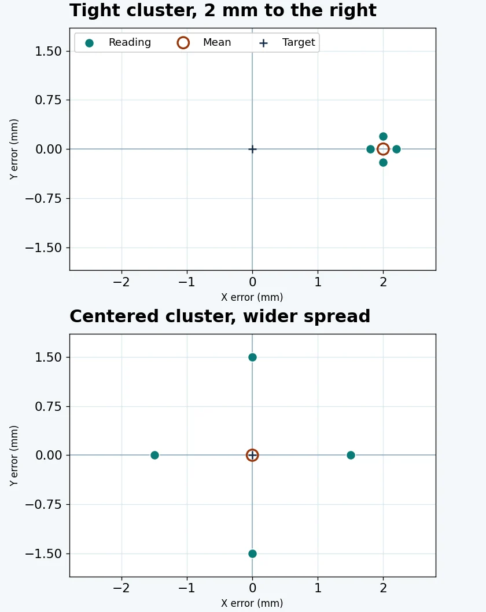

# Robot arm accuracy vs repeatability

Analyze synthetic robot endpoint readings using Python. There is no robot connection, hardware dependency or third party package needed for the lab.

Read the [full WIFA Robotics lesson](https://wifarobotics.com/learn/robot-arm-accuracy-vs-repeatability/) for the worked calculations, approach experiments and interpretation.

## Start here

1. Install Python 3.10 or newer from [python.org](https://www.python.org/downloads/) or through your operating system.
2. Download the repository ZIP from GitHub's **Code** menu. Extract it and open a terminal in the folder that contains `analyze.py`.
3. Run the commands below. Use `py -3` on Windows or `python3` on macOS and Linux.

```sh
python3 --version
python3 analyze.py examples/tight_offset.csv --target 100 50
python3 analyze.py examples/centered_wide.csv --target 100 50
python3 -m unittest discover -s tests -v
```

The first dataset should give a mean endpoint error of 2.000 mm and RMS spread of 0.200 mm. The second should give 0.000 mm and 1.500 mm respectively. The tests also check how two approach groups can hide a directional offset when pooled.



Use one common frame in millimetres. The CSV header must be `x_mm,y_mm` followed by at least two finite coordinate pairs. If Python cannot find the script, change into the extracted folder first. If a numeric field fails, check the comma delimiter and decimal point.

The tool reports descriptive 2D statistics for the readings supplied. It is not a robot motion program, a certified performance test or evidence of how any real robot performs. It ignores orientation, Z, instrument uncertainty and long term drift.

## Diagrams

The supplied WebP figures were plotted from the CSV data. To regenerate them, install Pillow and Matplotlib in a separate Python environment and run `python3 diagrams/render.py`. You can run the lab and tests without either package.
